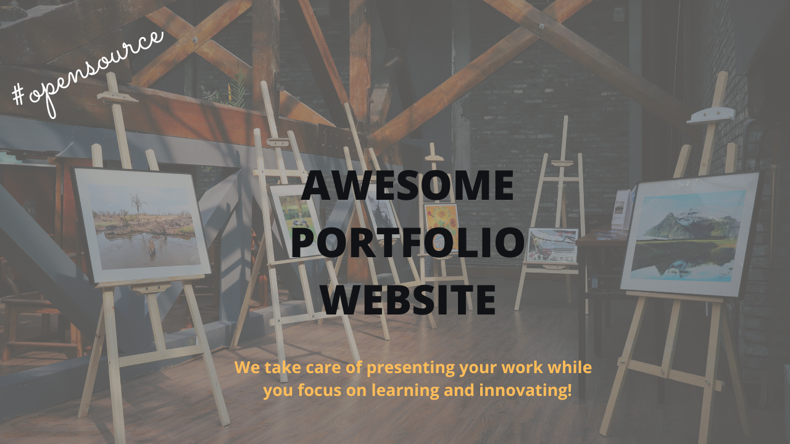

#### Home Page:
#### Experience Page:
#### Project Page:
#### Research Page:
#### Education Page:

## index page

1. Add your image to assets -> images folder

2. Open index.html
Change the  to your image path
To change the name on home page :

Change the name from John Doe to Your Name
To change the interests displayed :

Inside span tag, change the data-words with your interests
To add your social media links :

Inside 
 fill up the link to your social media accounts inside href

## Navbar

To change the name :
Open app.js
Under let header, inside <a class="navbar-brand" href="index.html">, change the name from John Doe to Your Name

## Footer
To change the quote :

Open app.js
Go to let footer, inside 
, change the quote inside
 from "Develop a passion for learning. If you do, you will never cease to grow." to your quote
To add your social media links :

Open app.js
Inside 
, under <a class="social-button" fill up the link to your social media accounts inside href="#" by replacing #. [ For example: <a class="social-button twitter" href="#" target="_blank"> Here, replace # with twitter account link]
  
  
  Experience Page

  
  
  
  
  
  
  
  
  
  
  
<!--  -->
<!-- 

 -->
